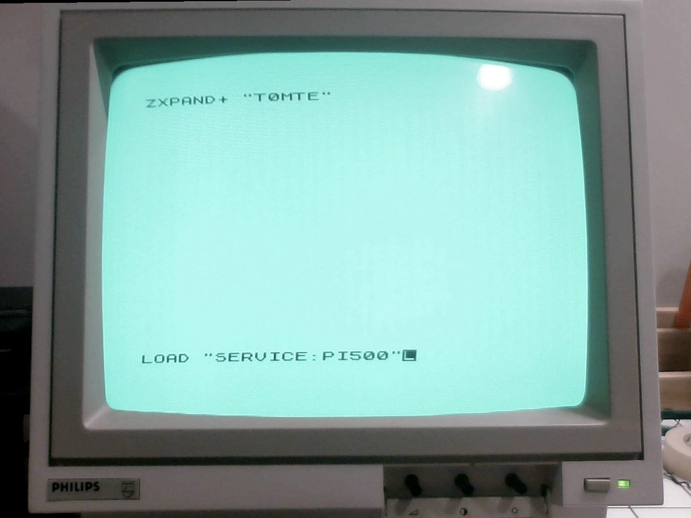
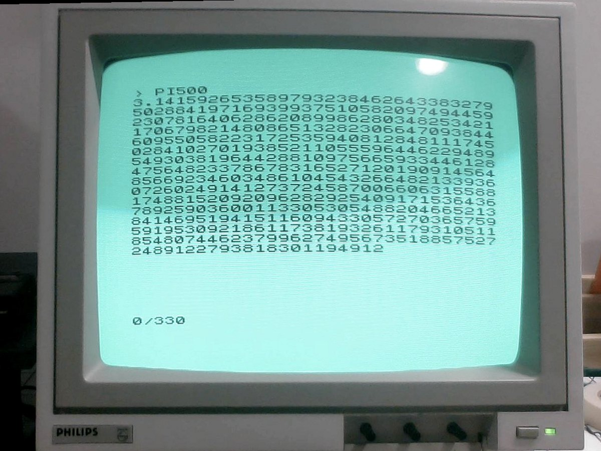
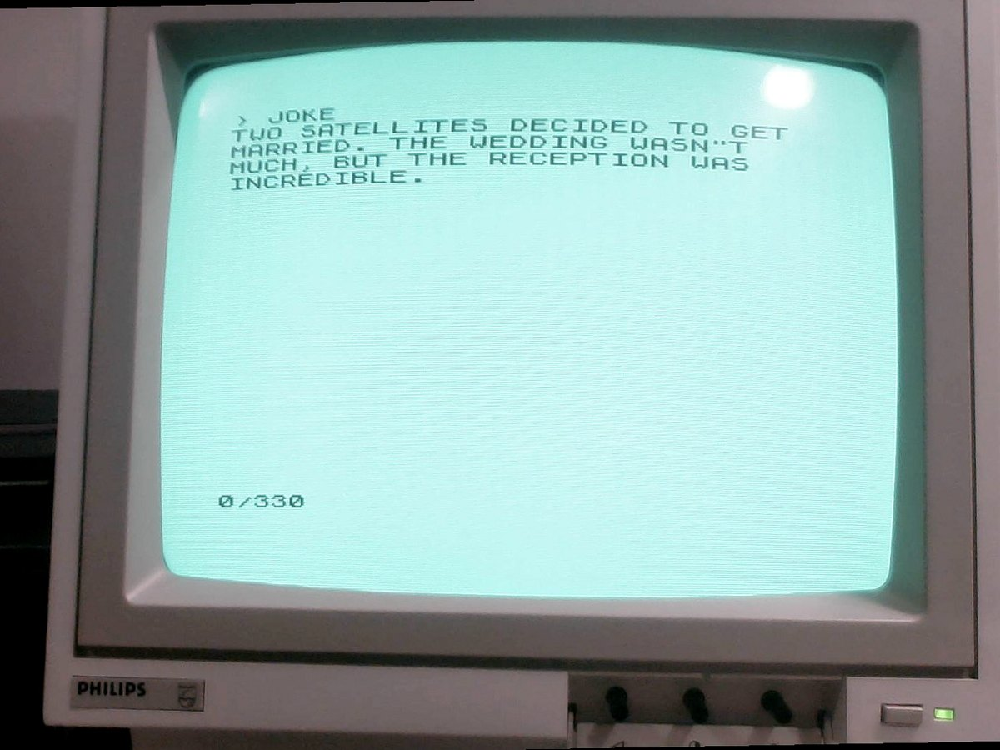

# zedwire

**Dad jokes, 500 digits of pi, the weather and the Commando theme, on a ZX81.**

Have you ever wanted your ZX81 to tell you dad jokes? Is the 3.1415927 you
get from `PRINT PI` just not accurate enough? zedwire connects a
**ZX81 with a ZXpand+** to a Mac or Linux machine through the ZXpand+'s
serial port and a cheap USB-serial adapter. Type `LOAD "SERVICE:JOKE"` and a
joke comes back; type `LOAD "SERVICE:PI500"` and you get 500 digits.

<p align="center">
  
  
  
</p>


What's in the box:

- **`SERVICE` + `zxservice.py`**: `LOAD "SERVICE:<keyword>"` on the ZX81
  runs a command on the Mac/Linux side and prints the answer on the ZX81
  screen. Jokes, fortunes, the time, the weather, a calendar, and arithmetic
  to more digits than the ZX81 has ever seen. **[docs/service.md](docs/service.md)**
- **`MUSIC` + `zxmusic.py`**: a ZX81 that plays chiptunes. `LOAD "MUSIC"`
  shows the music browser on the ZX81's screen, `LOAD "MUSIC:COMMANDO"` plays
  a tune. The computer turns the tune into AY register frames, so the ZX81
  only has to write them out to the ZXpand+'s sound chip, 50 times a
  second. **[docs/music.md](docs/music.md)**
- **`zxsvr`**: serves a `.p` file so `LOAD "$"` loads it over serial. A C
  port of Charlie Robson's `zxsvr.cs`.
- **Notes on the ZXpand+ serial API** ([docs/zxpand-serial.md](docs/zxpand-serial.md)),
  including the port-level receive commands the online manual doesn't cover.
  They were worked out from Charlie's example code and confirmed on real
  hardware.
- Small test programs for the link (`PINGPONG`), the AY (`AYTONE`) and the
  serial limits (`SERTEST`): see [docs/development.md](docs/development.md).

## What you need

- A ZX81 with a **ZXpand+** running the
  [TOMTE firmware](https://github.com/charlierobson/ZXpand-Vitamins#zxpand-vitamins).
- A **TTL-level** USB-serial adapter (FTDI or similar).
- Three wires: GND, TX, RX, crossed over. See **[docs/wiring.md](docs/wiring.md)**.
- A C compiler for `zxsvr`, and Python 3 for the rest.

Developed and tested on macOS (Apple silicon). `zxsvr` and `zxservice` have
also run on Linux (Fedora on a ThinkPad, a Raspberry Pi), and so has `zxmusic`
(browsing, playing, unplugging the adapter); what is still open on Linux is in
the checklist in [docs/testing.md](docs/testing.md).

## Quick start

```sh
make                       # builds ./zxsvr
```

Serial device names: on macOS use `/dev/cu.usbserial-*`. On Linux it's
usually `/dev/ttyUSB0`, and you need to be in the `dialout` group
(`sudo usermod -aG dialout $USER`, then log in again). To check the wiring
first, see [Check the link](docs/wiring.md#check-the-link).

**Load a program over serial:**

```sh
./zxsvr game.p /dev/cu.usbserial-XXXX        # add -l to keep serving repeated loads
```

On the ZX81: `LOAD "$"`. `zxsvr` prints every command byte as it arrives,
in hex, and exits by itself when the load is done. (It often shows a garbled
sign-off at the end; the load is fine, see
[zxpand-serial.md](docs/zxpand-serial.md#load--protocol-zxsvr).)

**SERVICE:**

```sh
cp services.conf.example services.conf
./zxsvr service/SERVICE.P /dev/cu.usbserial-XXXX      # LOAD "$" on the ZX81, then GOTO 35
./zxservice.py services.conf /dev/cu.usbserial-XXXX
```

`GOTO 35` saves SERVICE to the SD card the first time. From then on
`LOAD "SERVICE:TIME"`, `LOAD "SERVICE:JOKE"` and `LOAD "SERVICE:PI500"` work.
Details, the keyword list and updating: [docs/service.md](docs/service.md).

**MUSIC:**

```sh
python3 -m venv .venv && .venv/bin/pip install z80  # once
./zxsvr music/MUSIC.P /dev/cu.usbserial-XXXX        # LOAD "$" on the ZX81, then GOTO 35
.venv/bin/python zxmusic.py --setup                 # once: serial port, tunes folder, AY clock
.venv/bin/python zxmusic.py
```

Put some tunes in `tunes/` (none come with the repo: they belong to their
composers), then `LOAD "MUSIC"` on the ZX81. Formats, options, calibration and
how it works: [docs/music.md](docs/music.md).

## Documentation

| | |
|---|---|
| [docs/service.md](docs/service.md) | SERVICE: setup, `services.conf`, limits |
| [docs/music.md](docs/music.md) | MUSIC: the guide, tunes, options, pitch calibration |
| [docs/wiring.md](docs/wiring.md) | wiring, host side, the link check |
| [docs/zxpand-serial.md](docs/zxpand-serial.md) | the ZXpand+ serial API, wire protocols, serial limits |
| [docs/chiptunes.md](docs/chiptunes.md) | MUSIC design notes: why it is built this way |
| [docs/testing.md](docs/testing.md) | what was tested on real hardware, and what is open |
| [docs/development.md](docs/development.md) | repository layout, building, tests, test programs |

## Credits

- **Charlie Robson (sirmorris)** — the ZXpand and ZXpand+, their firmware,
  and [ZXpand-Vitamins](https://github.com/charlierobson/ZXpand-Vitamins).
  - `zxsvr.c` is a C port of his
    [`serial-server/zxsvr.cs`](https://github.com/charlierobson/ZXpand-Vitamins/tree/master/serial-server),
    with the same `I`/`T`/`X` protocol. The port adds loop mode, clean port
    teardown, hex diagnostics and handling of the garbled sign-off.
  - The port-level serial API used by the Z80 code comes from his
    [`serial-breakout/serialio.c`](https://github.com/charlierobson/ZXpand-Vitamins/blob/master/serial-breakout/serialio.c).
    How `LOAD "NAME:ARG"` arguments are read comes from
    [`midi-play/midiplay.asm`](https://github.com/charlierobson/ZXpand-Vitamins/blob/master/midi-play/midiplay.asm).
  - The [ZXpand online manual](https://github.com/charlierobson/ZXpand-Vitamins/wiki/ZXpand---Online-Manual)
    and the [serial server / `LOAD "$"`](https://github.com/charlierobson/ZXpand-Vitamins/wiki/Serial-Server-and-LOAD-%22$%22)
    wiki pages.
  - The music browser is modelled on his
    [ZXpand Commander](https://github.com/charlierobson/ZXpand-Vitamins/tree/master/zxpand-commander)
    (the look and the keys; the code is new).
- **Sergey Bulba (S.V. Bulba)** — the Vortex Tracker II PT3 player that
  `zxmusic.py` runs to play `.pt3` modules, included in
  [third_party/vt2-pt3-player](third_party/vt2-pt3-player) under his terms.
- **Jedi / Sector One** — the AY drums `zxmusic.py` plays in place of
  sampled ones are modelled on the drums in his Virtual Escape intro tune
  (Equinox, Atari ST), as converted to YM by Leonard (Arnaud Carré). No
  code or music is copied, only the pitches and volumes of his kick and
  snare.

## How this was made (AI disclosure)

This project was written with a lot of help from an AI assistant
(Anthropic's Claude). The C port, Python servers, Z80 code, build tools and
these docs were drafted in conversation with it. The wiring, continuity
testing and all hardware testing were done by hand on a real ZX81 and
ZXpand+, and the author decided what went in.

[docs/testing.md](docs/testing.md) lists what has actually been seen working on hardware.
The API notes mark anything inferred or untested as such. Corrections from
people who know the ZXpand+ better are very welcome — open an issue.

## License

MIT — see [LICENSE](LICENSE). Use it, change it, share it.

`zxsvr.c` is derived from `zxsvr.cs` in ZXpand-Vitamins, which has no
explicit license. It is included here with credit, in the spirit of that
project. If the upstream author would like it handled differently, please
open an issue.
