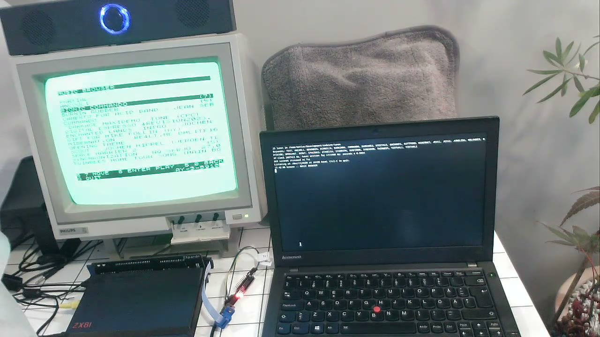
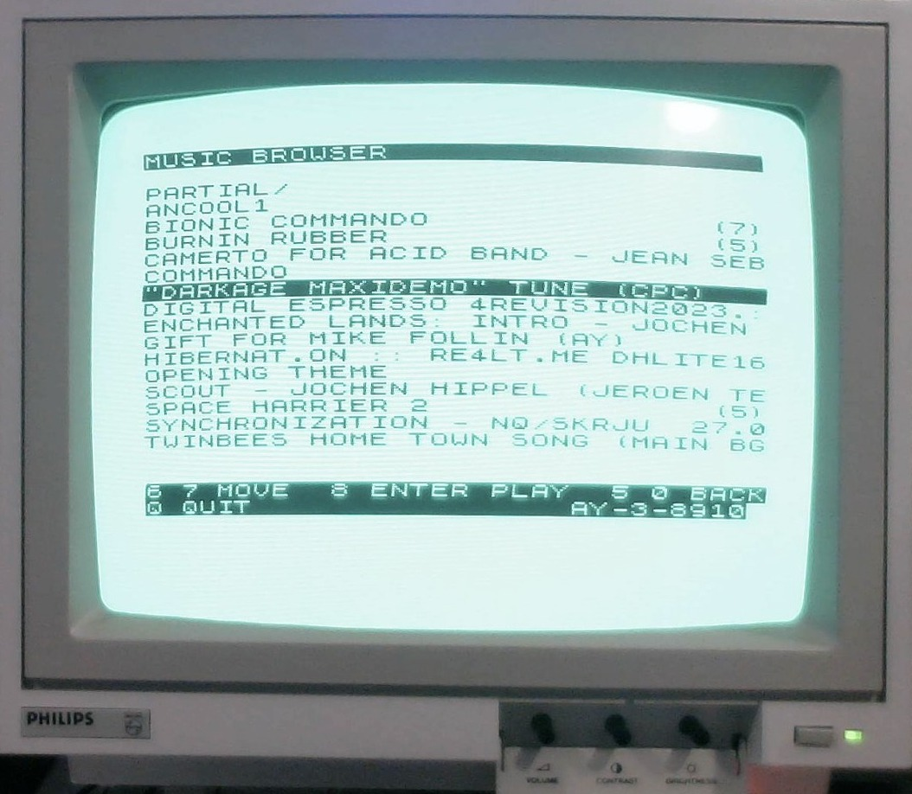

# MUSIC: chiptunes on the ZX81

```
LOAD "MUSIC:COMMANDO"
```

The ZXpand+'s AY chip plays it. The ZX81 has no sound of its own, so this is
streaming: `zxmusic.py` on a computer on the serial port turns a tune into AY
register values, 50 frames a second, and MUSIC only writes each frame to the
chip. Any format that can be turned into AY register writes plays, with no
player to fit in the ZX81's RAM ([why](chiptunes.md#streaming-register-frames)).

[](
https://github.com/user-attachments/assets/02eadad2-a32c-4256-addf-f63e1b4db300
)

*30 s demo (MP4, 8.5 MB, webcam sound, quiet): browsing the tunes, opening a multi-song file, picking a song (the pause is the laptop loading it), the music, and the server log on the laptop.*



<!-- PHOTO: docs/img/photos/music-playing.jpg - "PLAYING COMMANDO ON AY-3-8910" -->

**Prior art.** AY playback on the ZXpand+ already exists:
[ZXpand-Vitamins](https://github.com/charlierobson/ZXpand-Vitamins) has AY
sound-effect players (`sfxplay-mc`, `sfxplay-rem`, `ay-fx-demo`), and its
`midi-play` reads MIDI files from the SD card and sends them out of the
serial port at the MIDI data rate (to an external synth, not the AY). What
this adds, as far as we know: streaming AY music from a computer, so there is
no RAM or SD limit, and playing `.ay` (Spectrum and Amstrad CPC), `.ym`,
`.vgm` and `.pt3` files that way.

## Quick start

Hardware: see the [README](../README.md#what-you-need) and
[wiring.md](wiring.md). No tunes come with the repo; they belong to their
composers.

```sh
make                                                 # builds ./zxsvr
python3 -m venv .venv && .venv/bin/pip install z80   # for .ay and .pt3
./zxsvr music/MUSIC.P /dev/cu.usbserial-XXXX         # LOAD "$" on the ZX81
.venv/bin/python zxmusic.py --setup                  # once: serial port, tunes folder, AY clock
.venv/bin/python zxmusic.py
```

On Linux the `z80` package has no ready-made wheel for every Python, so pip
builds it from source: that needs a C++ compiler and the Python headers
(Fedora: `sudo dnf install gcc-c++ python3-devel`; Debian/Ubuntu:
`sudo apt install g++ python3-dev`).

**First time**, on the ZX81: `GOTO 35`. This saves MUSIC to the SD card as a
self-starting program and runs it; `zxsvr` isn't needed for MUSIC again.
**Updating** to a newer `MUSIC.P`: load it with `zxsvr` and type `GOTO 30`
instead. It deletes the old file first (`SAVE` doesn't replace it, so the old
one would keep loading). Then:

```
LOAD "MUSIC"                  the music browser
LOAD "MUSIC:TEST"             2 s of A 440 Hz, then a scale
LOAD "MUSIC:COMMANDO"         a tune by keyword
```

Start with `TEST` and a tuner: 440 Hz means the link, the AY and the pitch
calibration are fine. The serial port is `/dev/cu.usbserial-*` on macOS and
usually `/dev/ttyUSB0` on Linux. With one adapter plugged in, `zxmusic.py`
needs no `--setup`. `zxmusic` and `zxservice` can't run at the same time.

## On the ZX81

**Music browser** (`LOAD "MUSIC"`), in the style of ZXpand Commander: 18 entries a
page, folders first, the sound chip in the corner.

| Key | |
|---|---|
| `6` / `7`, cursor keys | down / up; off the end of a page turns it |
| `8`, Enter | open a folder, play a tune |
| `5`, `0`, `.` | up a folder |
| `Q` | quit to BASIC |

A file with several songs shows `(n)`; opening it lists them. Any key stops a
tune and returns to the list.

**Keywords.** Every tune has one, made from its file name (up to 8 letters and
digits: `..._BionicCommando.ay` becomes `BIONICCO`; clashes get a number).
The server prints them at start-up. `LOAD "MUSIC:BIONICCO/3"` plays song 3.
Keywords of your own in `music.conf` can be up to 27 characters, the most
`LOAD "MUSIC:..."` can carry.
No spaces after the colon: `LOAD` cuts the argument at the first one.

**While a tune plays**, a small spinner next to `ANY KEY TO STOP` fills a
block a quarter at a time and empties it again, about three steps a second.
It moves once per good frame received; if it stands still, no good frames are
arriving and the sound is being held.

**After a tune** MUSIC shows why it stopped and three counters:

| | |
|---|---|
| `BAD` | frames dropped for a bad checksum. A few are harmless |
| `UNDERRUNS` | the next frame hadn't arrived: the sound was held |
| `LATE` | 50 Hz ticks the ZX81 missed |

All three are 0 on full-length tunes on the author's setup.

## Tunes

Put them in the tunes folder (`tunes/` by default; subfolders are fine). It is
rescanned on every request, so new files show up without a restart. File
info is cached in `~/.cache/zedwire/library.json`. Files the AY can't play are
left out. Tunes the AY can never play are moved to `unsupported/` (see below).

| Format | Notes |
|---|---|
| `.ay` | Spectrum or Amstrad CPC music with its own Z80 player. The player runs in a Z80 emulator on the computer (needs the `z80` package) and its AY writes are captured. CPC players are detected and pitched for the CPC's 1 MHz AY. `KEYWORD/N` picks a song. A play routine that waits for the frame interrupt (`HALT`) is supported, and so is an `INIT` that never returns because it is the tune's main loop (`EI`, `HALT`) with an interrupt handler doing the playing. Beeper tunes (the 48K ones: the player drives the Spectrum's beeper and never writes to the AY) and sampled sound (`(Sample)` and speech songs) can't be played, so they aren't listed: see Unsupported tunes below |
| `.pt3` | Pro Tracker 3 / Vortex Tracker II, played by S.V. Bulba's PT3 player ([third_party](../third_party/vt2-pt3-player)) in the same emulator. TurboSound modules: one module plays, `\| ts=2` picks the other |
| `.ym` | Atari ST dumps, YM2 to YM6, LHA-compressed or not. Digidrums and YM6 effects aren't played |
| `.vgm`, `.vgz` | with an AY-3-8910 family chip. VGMs without one are refused |
| `.psg` | AY register dumps |
| STC, ASC, PT2, ... | converted with `zxtune123`, if installed (`--zxtune` gives its path) |

`tools/tunecheck.py FILE-OR-FOLDER` says whether a tune is **complete** (all
AY), **partial** (other chips, a second AY, sampled drums, YM effects: it
plays but something is lost) or has **no AY**.

**Unsupported tunes.** When a new file turns out to be something the AY can never
play, the server moves it to `unsupported/` in the tunes folder, which isn't
scanned, and logs `moved X to unsupported/X: why` (a file keeps its subfolder there).
Nothing is moved that changed in the last minute, in case it is still being
copied, and never a file `music.conf` names. That covers `.ay` files
that only have beeper or sampled-sound songs, VGMs for chips without an AY,
and sampled `.ym` files. In an `.ay` that mixes such songs with real ones, only
the real songs are listed. A sampled song writes a volume register thousands
of times in a few frames (speech, sound effects); a 50 Hz stream sees only
the last value, so nothing is left to play. A beeper tune has no AY part at all.

What gets lost on a single AY with three channels:

- **Konami SCC** (MSX VGMs): one SCC voice is folded onto an AY channel the
  tune doesn't use. `| scc=3` picks the voice, `| scc=off` plays the AY only.
- **Sampled drums** (Atari ST, e.g. Jochen Hippel): can't be streamed at
  50 Hz, so `zxmusic.py` finds the hits and plays AY kicks and snares instead,
  modelled on the drums in Jedi's *Virtual Escape*.
- **TurboSound** (two AYs): half the channels.

## Options

### music.conf

Optional, next to `zxmusic.py`: keywords of your own and per-tune options, see
[music.conf.example](../music.conf.example). Options apply however the tune is
picked.

```
COMMANDO=tunes/Project AY_Spectrum_Demos_Commando.ay
BIONIC3=tunes/bioniccommando.ay@3                  # song 3 of the file
JUNGLE=tunes/msx-tune.vgz | scc=3
SURFING2=tunes/turbosound.pt3 | ts=2
```

| Option | |
|---|---|
| `scc=N`, `scc=N,M`, `scc=off` | MSX VGM: SCC voice(s) onto free AY channels; AY only |
| `ts=2` | TurboSound PT3: the second module |
| `drums=held` | sampled drums as AY drums (default) |
| `drums=env` | a softer AY drum |
| `drums=kicks`, `drums=snares` | only that kind; the other muted |
| `drums=off` | sampled drums muted |

### zxmusic.py

Settings from `--setup` are saved in `zxmusic.ini`; options given on the
command line win.

| Option | Default | |
|---|---|---|
| `DEVICE` | from `--setup`, or the only adapter | serial port |
| `--tunes` | `tunes/` | tunes folder |
| `--config` | `music.conf` if present | |
| `--ay-clock` | 1,625,000 | your AY clock in Hz |
| `--tune-clock` | 1,773,400 | the clock tunes were written for (ZX Spectrum). Pentagon: 1750000 |
| `--window` | 10 | frames in flight (150 bytes); 16 at most |
| `--no-scc` | off | VGM: AY part only, for all tunes |
| `--zxtune` | from `PATH` | path to `zxtune123` |
| `--baud` | 38400 | MUSIC uses 38400: leave it |

## Pitch

The AY runs at half the ZX81's clock: 1.625 MHz on paper, but the ZX81 clock
comes from a ceramic resonator and differs between machines (the author's
runs 1.15% slow, about a fifth of a semitone). All periods are rescaled from
the tune's clock (the file's own for YM and VGM, 1 MHz for CPC, 1.7734 MHz for
the rest) to `--ay-clock`. To measure yours:

1. Load AYTONE (`./zxsvr aytone/AYTONE.P /dev/cu.usbserial-XXXX`, then
   `LOAD "$"` on the ZX81), `RUN 300`: ten beeps in `FAST` mode, one every
   6,500,420 Z80 T-states (2.0001 s at 3.25 MHz).
2. Record them (any microphone, about 25 s).
3. Give the recording to `zxmusic.py --setup` (runs `tools/ayclock.py`, needs
   numpy), or run `tools/ayclock.py` yourself:

```sh
.venv/bin/pip install numpy                  # once
.venv/bin/python tools/ayclock.py recording.m4a
```

```
Tone: 398.399 Hz (± 0.003), tone 144x louder than the quiet parts
AY clock: 1.6063 MHz  (16 x 252 x 398.399 Hz)
Beeps: 10, one every 2.02340 s (timing scatter 0.4 ms)
CPU clock: 3.2126 MHz  (-1.15% from 3.25 MHz)
AY / CPU: 0.50001  - the AY runs off the ZX81 clock / 2

==> AY clock for zxmusic.py: 1606345 Hz
    Type 1606345 at the zxmusic.py --setup prompt, or run it with --ay-clock 1606345
```

The pitch gives the AY clock, the beep spacing the ZX81's CPU clock. **The
last line is the number to type** at the `--setup` prompt or give as
`--ay-clock`.

Check with `MUSIC:TEST` and a tuner. 60 Hz machines aren't handled.

## AYTONE

A tone, register read-back, clock test and chip check from machine code. No
serial needed after loading. Load it as above and `RUN`, then give a tone
period (`252`). Expected:

```
PERIOD 252, READ BACK 252
AT 1.7734MHZ: 440 HZ
ANY KEY TO STOP
```

and a steady tone on channel A until a key. `READ BACK` is the period read
from the chip; `65535` (`NO ANSWER FROM THE AY?`) means nothing answered on
port `$CF`. A tuner showing *f* Hz for period *P* means an AY clock of
16 × *P* × *f* Hz. After a `BREAK`, `RUN 160` silences the chip;
`POKE 16522,V` (0-15) sets the volume of the next tone.

**Which chip?** (`RUN 500`): writes `$FF` to two registers that don't use all
their bits and reads them back. An AY-3-8910 returns the unused bits as 0
(`R1 READ BACK 15, R6 31`), a YM2149 as written (255, 255), per
[MAME's AY driver](https://github.com/mamedev/mame/blob/master/src/devices/sound/ay8910.cpp).
Chips sold as AY-3-8910 are often relabelled.

## How it works

```
 computer                                      ZX81 + ZXpand+
 zxmusic.py                       serial       MUSIC (Z80, in a REM)
  tune -> 15-byte frames, 50/s  ── frame ──>   write R0-R13 to the AY ($CF/$0F)
  paced by credits              <── 'k' ────   one per 4 frames taken
  tune library, browser pages   <── '?' ────   music browser requests
```

- **Frame**: AY registers R0-R12, R13, checksum (all 15 bytes add up to 0).
  750 bytes/s. Every frame carries the whole register set, so a frame with a
  bad checksum is dropped and the next one repairs it. About 1 byte in 15,000
  arrives changed. If a byte is lost or added, MUSIC finds the framing again
  by sliding over the stream (two frames are lost).
- **Credits**: the ZX81 sends `k` per 4 frames; the server keeps at most 10
  frames (150 bytes) in flight. **256 unread bytes hard-freeze the ZXpand+**
  (power cycle), so nothing is ever sent without credits. Browser replies use
  them too (`k` per 64 bytes, at most 128 ahead, 8 bytes every 12 ms).
- **Music browser**: the server keeps the position; the ZX81 sends `?`, `?N`, `?P`,
  `?0`, `?T` or `?<row>` and gets a page (checksummed) or the keyword of the
  tune picked. Pages are drawn through the ROM (`CLS`, `PRINT AT`, `RST $10`),
  not by writing the display file, which isn't always fully expanded.
- **Chip**: MUSIC tells AY-3-8910 from YM2149 by reading back unused register
  bits, and shows which.

Design notes: [chiptunes.md](chiptunes.md). Byte-level protocol and the Z80
entry points: [zxpand-serial.md](zxpand-serial.md#music-wire-protocol-zxmusic).

## Troubleshooting

| | |
|---|---|
| a tune stops by itself, the log says `no credits for 3 s` | the computer may have gone to sleep (the ZX81 gives up after 2 s). Check your power settings. Examples of holding a sleep lock: `caffeinate -i ./zxmusic.py` (macOS), `systemd-inhibit --what=idle:sleep --who=zxmusic --why=streaming ./zxmusic.py` (Linux; over SSH it asks for a password) |
| `NO REPLY - IS ZXMUSIC UP?` | `zxmusic.py` not running, wrong port, or `zxservice` has the port |
| `NO SUCH TUNE ON THE SERVER` | not a keyword the server printed, or the tune failed to load (see the server log) |
| tune not in the list | `tools/tunecheck.py FILE` says why. `.ay` and `.pt3` need the `z80` package |
| ZXpand+ dead | frozen: power cycle. Shouldn't happen; if you can make it, open an issue |
| `BAD` high | shorter wires, another adapter. A changed byte counts 1, a lost or added byte 2 |
| out of tune | calibrate (above) |
| old behaviour after an update | the old `MUSIC.P` is still on the SD card: `GOTO 30` (see Quick start) |
| `Cannot open /dev/...` | wrong port; on Linux, join `dialout` |

## Limits

- One AY: TurboSound tunes lose half their channels.
- The computer has to be there: there is no playback from the SD card.
- Mono output (a CRT's speaker) takes one side of the ZXpand+'s stereo mix and
  may lose a channel. Sum L and R with resistors; don't join them with a Y
  cable.
- The real chip sounds softer than an emulator: there is an analogue filter
  after it.

## Files

| Path | |
|---|---|
| `zxmusic.py` | the server |
| `tunelib.py` | tune folder scan, keywords, browser pages |
| `music/music.asm`, `music.bas`, `MUSIC.P` | the ZX81 side (`make zx` rebuilds) |
| `music.conf.example` | keywords and options |
| `third_party/vt2-pt3-player/` | Bulba's PT3 player |
| `tools/tunecheck.py`, `tools/ayclock.py` | tune check, clock measurement |
| `aytone/` | tone and clock test |
